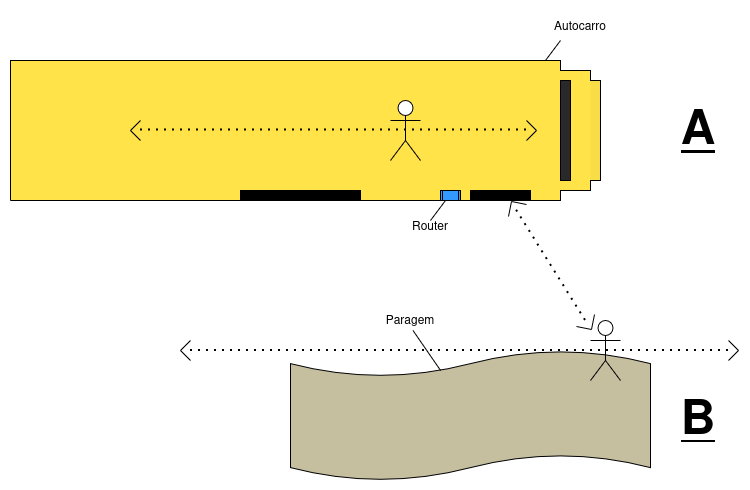

# inMotion

WiFi RSSI mobility classification: infer where a passenger is (inside the bus,
at the stop) and which transition they are making, from signal-strength
sequences captured by a fixed access point.

Part of the inMotion project (Integrated AI Platform for Urban Mobility and
Transportation), a copromotion between Wavecom and Instituto de Telecomunicações.

## Domain

**Route labels** — each row is one 10-second route, 10 RSSI readings at 1 Hz:

| label | meaning |
|---|---|
| `AA` | stayed inside the bus |
| `BB` | stayed at the stop |
| `AB` | alighted (inside → outside) |
| `BA` | boarded (outside → inside) |

Each row also carries `mac` (device identifier) and `noise` (whether other
devices were transmitting concurrently). See `docs/eucnc/project_description.md`
for the collection protocol.



## Setup

```bash
uv sync --all-packages      # root project plus the demo workspace member
cp env.example .env         # credentials (never committed)
set -a && . ./.env && set +a
```

Check the environment and the artifact store:

```bash
uv run inmotion doctor
```

## Running a model you trained

This is the part that used to require reading the training scripts.

```bash
uv run inmotion model list                 # every known model, and whether it is on disk
uv run inmotion model info ts_jepa         # architecture, parameter count, provenance
uv run inmotion model verify               # strict-load all of them
uv run inmotion model predict ts_jepa --input new_routes.csv
```

`model predict` needs to know how the inputs were scaled, because the original
training code never saved its `StandardScaler`. Pass the CSV the model was
trained on as `--reference`, or rely on the default for its feature set.
Predictions built on reconstructed statistics say so.

A checkpoint that predates the sidecar convention can be adopted:

```bash
uv run inmotion model adopt path/to/checkpoint.pt --name my_model
uv run inmotion model inventory 20-aug        # scan a whole directory
```

Adoption rebuilds the architecture from the weights and refuses to guess when
several architectures fit (TS-JEPA and CF-JEPA at equal width are genuinely
indistinguishable). It reports the ambiguity instead.

> **Note:** `*_pretrain_best.pt` files are pre-training bundles, not classifiers.
> See `docs/reports/ARTIFACTS.md`.

## Datasets

Datasets are committed to git, so their history is the version history.
`data/DATASETS.json` adds the parts git cannot express: checksums, row and class
counts, lineage, and which versions are safe to train on.

```bash
uv run inmotion datasets list
uv run inmotion datasets show ds-augmented-v3
uv run inmotion datasets verify            # detect a file changed under git's feet
```

Current versions, newest lineage last:

| id | file | rows | notes |
|---|---|---|---|
| `ds-pure` | `dataset_only_pure.csv` | 160 | early collection — **labels reported incorrect** |
| `ds-noise` | `dataset_only_noise.csv` | 1,196 | early collection — **labels reported incorrect** |
| `ds-augmented-v1` | `dataset_augmented.csv` | 10,113 | augmentation config 1 — **labels reported incorrect** |
| `ds-icaisf` | `dataset.icaisf.csv` | 2,251 | the ISAC paper's variant; labels unverified |
| `ds-base-v2` | `dataset.csv` | 3,511 | current base, 13 devices |
| `ds-augmented-v2` | `dataset_augmented2.csv` | 20,275 | augmentation config 2 (superseded) |
| `ds-augmented-v3` | `dataset_augmented3.csv` | 35,839 | **canonical training set** |

`ds-augmented-v3` is what the JEPA and SIGReg checkpoints were trained on, so it
is the reference for reproducing their preprocessing. Full detail, including
lineage and checksums, is in [`docs/reference/datasets.md`](docs/reference/datasets.md).

Building datasets from raw captures:

```bash
uv run inmotion data export --input wavecom_files/routeAtoB.txt --output data/AB.csv \
  --group G1:<mac1>,<mac2> --group-label G1:AB
uv run inmotion data merge --input data --output dataset.csv
uv run inmotion data clean  -- --data dataset.csv
uv run inmotion data augment -- ...
```

## Training and evaluation

Pipelines are invoked through one entry point; arguments pass through unchanged.

```bash
uv run inmotion run list
uv run inmotion run pipeline exotic -- --model ts_jepa --seed 42
uv run inmotion run pipeline dl     -- --seed 42
uv run inmotion run pipeline mega-ensemble -- --data dataset_augmented3.csv
```

Cluster submission scripts are in `scripts/slurm/`, single-machine runs in
`scripts/local/`; see `scripts/README.md`.

## Tests

```bash
uv run pytest tests/                          # root suite
cd demo && uv run --project . pytest          # demo is a separate workspace member
uv run ruff check src dl ml_classification tests
uv run ruff format --check src dl ml_classification tests
uv run python scripts/docs/generate_reference.py --check
```

All of these also run in CI (`.github/workflows/ci.yaml`).

Model tests verify that every documented checkpoint loads with `strict=True` and
matches its recorded parameter count, and that each model's output still matches
a frozen fingerprint. They skip with a reason when the (gitignored) checkpoint
store is absent.

## Layout

```
src/inmotion/          the package
  cli.py               the `inmotion` entry point
  models/              registry, factories, sidecars, adoption
  data/                tier paths, feature pipeline, export/merge/clean/augment
  pipelines/           training and evaluation pipelines + their registry
  evaluation/          checkpoint evaluation, SHAP, feature importance
  analysis/  viz/      multi-seed analysis, figure regeneration
data/
  raw/ interim/ processed/   the three data tiers
  DATASETS.json        checksums, lineage, label provenance
docs/                  papers (frozen), reference (generated), guides, audit
scripts/               slurm/ local/ archive/ oneoff/ docs/
tests/                 contract, adoption, CLI, docs, secrets guard
demo/                  FastAPI demo (separate workspace member, own image)
backup/  20-aug/       checkpoint stores (not tracked)
plots/  results/       generated output (not tracked)
```

## Auditability

For a review, these are the entry points: [`docs/audit/AUDIT_CHECKLIST.md`](docs/audit/AUDIT_CHECKLIST.md)
lists every claim and the command that verifies it, and
[`docs/audit/MODEL_CARDS.md`](docs/audit/MODEL_CARDS.md) states each model's
purpose and limitations. Known discrepancies — including three checkpoints whose
parameter counts do not match the published table — are documented in
[`docs/reproducibility.md`](docs/reproducibility.md) rather than omitted.

## Documentation

**[`docs/README.md`](docs/README.md) is the documentation index.** Start there.

| document | contents |
|---|---|
| [`docs/architecture.md`](docs/architecture.md) | how data flows, the model families, the registry, sidecars |
| [`docs/reproducibility.md`](docs/reproducibility.md) | environment, seeds, split, and what is **not** reproducible |
| [`docs/guides/running-models.md`](docs/guides/running-models.md) | list, inspect, verify, predict, adopt |
| [`docs/guides/training.md`](docs/guides/training.md) | training each family, on a workstation or a cluster |
| [`docs/reference/`](docs/reference/) | generated: CLI, models, modules, datasets |
| [`docs/audit/AUDIT_CHECKLIST.md`](docs/audit/AUDIT_CHECKLIST.md) | what a reviewer can verify independently |
| [`docs/audit/MODEL_CARDS.md`](docs/audit/MODEL_CARDS.md) | per-family model cards and limitations |
| [`docs/isac/results/MASTER_RESULTS.md`](docs/isac/results/MASTER_RESULTS.md) | canonical reported numbers, each mapped to its artifact |
| [`docs/reports/`](docs/reports/) | artifact rules, migration notes, refactor history |

## Citing

Dataset DOI: [10.21227/55nm-0r91](https://doi.org/10.21227/55nm-0r91)
